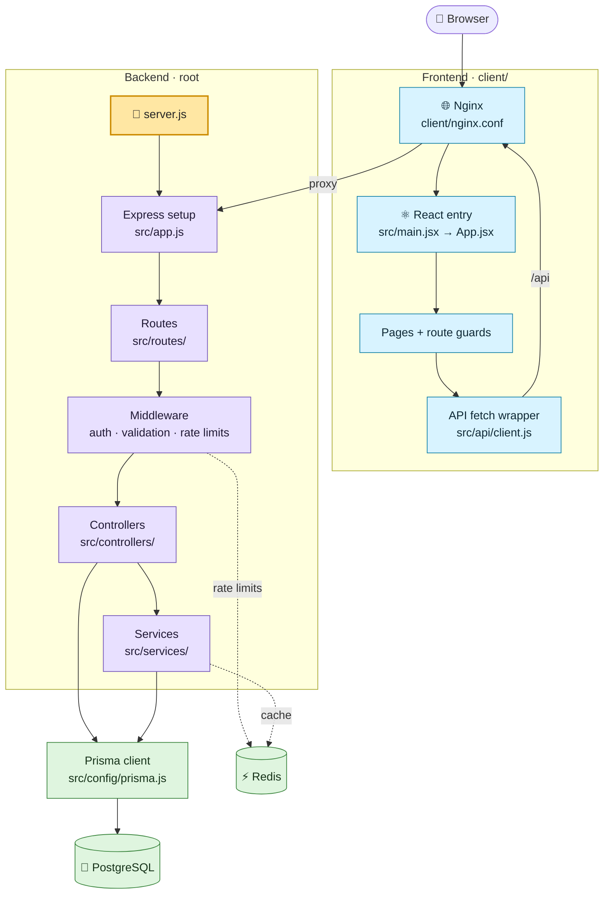

docker compose downdocker compose down# 🏦 Banking System

> **A quick visual guide to where the app starts, how a request moves, and which files to open next.**

## Start here

```text
docker-compose.yml
   ├── PostgreSQL  → stores banking data
   ├── Redis        → cache + shared rate limits
   ├── Backend      → Dockerfile → server.js → src/app.js
   └── Frontend     → client/Dockerfile → Nginx → React app
```

**To run it:** `docker compose up -d`  ·  **Open the app:** [http://localhost](http://localhost)

## System map
docker compose downdocker compose down


## The entry gates

| What you are starting | First file | Then it goes to |
|---|---|---|
| Whole Docker app | [docker-compose.yml](docker-compose.yml) | PostgreSQL, Redis, backend, frontend |
| Backend API | [Dockerfile](Dockerfile) → [server.js](server.js) | [src/app.js](src/app.js) → routes → middleware → controllers |
| Frontend site | [client/Dockerfile](client/Dockerfile) → [client/nginx.conf](client/nginx.conf) | [client/src/main.jsx](client/src/main.jsx) → [client/src/App.jsx](client/src/App.jsx) → page |
| Database access | [src/config/prisma.js](src/config/prisma.js) | [prisma/schema.prisma](prisma/schema.prisma) → PostgreSQL |

## Follow one transfer

```mermaid
sequenceDiagram
    actor You as User in browser
    participant Page as Transfer page
    participant Nginx
    participant Express as Express app
    participant Route as Transaction route
    participant Checks as Auth + validation + fraud check
    participant Controller as Transaction controller
    participant DB as PostgreSQL / Prisma
    participant Cache as Redis

    You->>Page: Submit recipient, amount
    Page->>Nginx: POST /api/transactions
    Nginx->>Express: Proxy API request
    Express->>Route: Match transaction route
    Route->>Checks: Authenticate and validate
    Checks->>Controller: Continue if allowed
    Controller->>DB: Check balance; write transfer + debit/credit ledger
    DB-->>Controller: Commit transaction
    Controller->>Cache: Invalidate updated balances
    Controller-->>Page: JSON result
    Page-->>You: Show success or error
```

The implementation is in [src/routes/transaction.routes.js](src/routes/transaction.routes.js), [src/middleware/fraudCheck.js](src/middleware/fraudCheck.js), and [src/controllers/transaction.controller.js](src/controllers/transaction.controller.js). The ledger writes run inside one PostgreSQL transaction so all entries commit together.

## Frontend pages

```text
client/src/App.jsx
├── /login, /register                   public
├── /dashboard                          signed-in user
├── /dashboard/transfer                 signed-in user
├── /dashboard/transactions             signed-in user
└── /admin/*                            admin role
    ├── /admin                          overview
    ├── /admin/fraud-alerts              review alerts
    ├── /admin/seed-funds                add test funds
    ├── /admin/users                     user list
    └── /admin/ledger                    ledger viewer
```

Pages call [client/src/api/client.js](client/src/api/client.js), which sends cookie-authenticated requests to `/api`. In Docker, the browser reaches Nginx first; Nginx serves the React files and forwards API calls to Express.

## Important files

| Layer | Files | Responsibility |
|---|---|---|
| Startup | [docker-compose.yml](docker-compose.yml), [server.js](server.js), [src/app.js](src/app.js) | Start services and configure the API |
| Routes | [src/routes/](src/routes/) | Map URLs to middleware and controllers |
| Middleware | [src/middleware/](src/middleware/) | Authentication, roles, validation, fraud checks, rate limits, errors |
| Business logic | [src/controllers/](src/controllers/), [src/services/](src/services/) | Perform account, transaction, admin, email, and fraud operations |
| Data | [prisma/schema.prisma](prisma/schema.prisma), [prisma/migrations/](prisma/migrations/) | Define and evolve PostgreSQL tables |
| Connections | [src/config/prisma.js](src/config/prisma.js), [src/config/redis.js](src/config/redis.js) | Connect to PostgreSQL and Redis |
| API reference | [src/config/swagger.json](src/config/swagger.json) | Swagger docs at `http://localhost:4000/api-docs` |
| Demo accounts | [src/scripts/seedSystem.js](src/scripts/seedSystem.js), [src/scripts/seedAdmin.js](src/scripts/seedAdmin.js) | Create local testing accounts |

## Addresses and commands

| Purpose | Use |
|---|---|
| Banking app | [http://localhost](http://localhost) |
| API health | [http://localhost/api/health](http://localhost/api/health) · direct: `http://localhost:4000/api/health` |
| Swagger API docs | [http://localhost:4000/api-docs](http://localhost:4000/api-docs) |
| Start | `docker compose up -d` |
| Check containers | `docker compose ps` |
| Backend logs | `docker compose logs -f backend` |
| Stop | `docker compose down` |
| Rebuild after code changes | `docker compose up -d --build` |

> PostgreSQL and Redis data live in Docker volumes. `docker compose down` stops/removes containers but keeps those volumes.
docker compose downdocker compose down