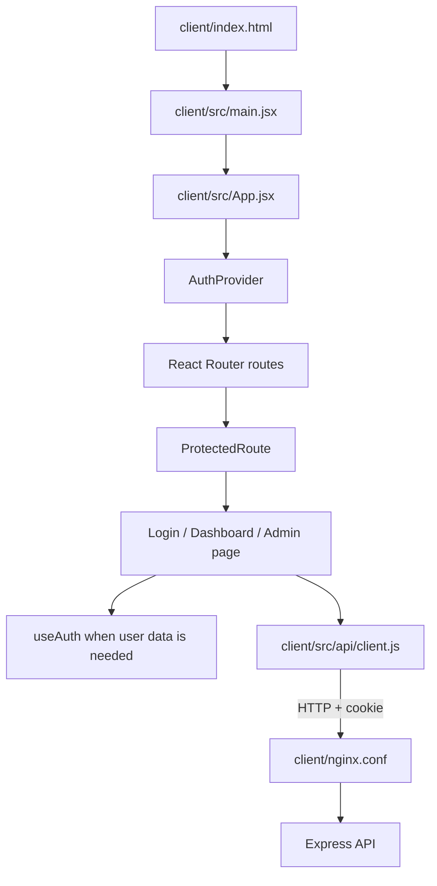

# Client Side Code Guide

This guide follows the client in the order the browser encounters it: HTML shell → React startup → routes and authentication → API helper → screens → styles and build/deployment files.

## 1. Big picture



In Docker, Nginx serves the built React files and proxies `/api` requests to Express. During local Vite development, [vite.config.js](client/vite.config.js) proxies `/api` to `http://localhost:3000`.

## 2. Follow the startup path

### Step 1 — `client/index.html`: the browser's HTML shell

This is the page Nginx serves. The important pieces are:

```html
<div id="root"></div>
<script type="module" src="/src/main.jsx"></script>
```

`#root` is the empty element React takes over. `type="module"` loads the JavaScript as an ES module, which allows `import` and `export`.

### Step 2 — `client/src/main.jsx`: mount React

`main.jsx` imports global CSS and the top-level `App` component, finds the `root` element, and renders into it:

```jsx
createRoot(document.getElementById('root')).render(
  <StrictMode>
    <App />
  </StrictMode>,
)
```

- `createRoot(...)` starts a React root in the HTML element.
- `<App />` is a React component written in JSX.
- `<StrictMode>` helps surface some development-time problems. It does not add a visible page element.
- `import './index.css'` applies the app's shared visual styles.

### Step 3 — `client/src/App.jsx`: route map and shared layout

`App.jsx` sets up `<BrowserRouter>` and `<Routes>`. A `<Route>` maps a URL path to a React element. For example:

```jsx
<Route path="/dashboard/transfer" element={<Transfer />} />
```

The component functions have these jobs:

- `App()` wraps routes in `<AuthProvider>` so all pages can access current-user state.
- `AppLayout()` shows the shared `<Sidebar />` plus `<Outlet />`; `Outlet` is where the selected child page appears.
- `AuthRedirect()` sends an already signed-in user away from login/register to the dashboard.

Routes are grouped under `<ProtectedRoute>`: customer pages require a signed-in user, while `/admin/*` also requires the `admin` role. The `*` route catches unknown paths and redirects to the dashboard.

### Step 4 — `client/src/context/AuthContext.jsx`: shared login state

React Context lets distant components read the same user state without passing props through every level.

```jsx
const [user, setUser] = useState(null);
const [loading, setLoading] = useState(true);
```

- `useState(initialValue)` gives a component state and a setter. Calling the setter asks React to render again with the new value.
- `useEffect(() => { ... }, [])` runs once after the provider first renders. This effect calls `auth.me()` to restore the session from the browser's cookie.
- `.then(...)`, `.catch(...)`, and `.finally(...)` handle success, failure, and cleanup of that asynchronous request.
- `<AuthContext.Provider value={{ user, loading, login, register, logout }}>` publishes those values to its children.
- `useAuth()` is a custom hook that reads the context. The guard inside it throws a clear error if a component uses it outside the provider.

The login flow is: page calls `login` → API sets the HTTP-only cookie → context calls `/auth/me` → context stores the returned user → route redirects to `/dashboard`. The password/token is not stored in browser `localStorage`.

### Step 5 — `client/src/components/ProtectedRoute.jsx`: access checks

This component is a route guard. It returns different JSX depending on state:

```jsx
if (loading) return <LoadingIndicator />;
if (!user) return <Navigate to="/login" replace />;
if (adminOnly && user.role !== 'admin') return <Navigate to="/dashboard" replace />;
return children;
```

`<Navigate>` changes the route. `replace` replaces the current browser history entry so Back does not send the user into a protected route again.

### Step 6 — `client/src/api/client.js`: the API doorway

Pages call named helpers such as `auth.login(...)`, `accounts.list()`, or `transactions.create(...)`. Those helpers use `apiRequest()` so headers, cookies, JSON parsing, and error handling are consistent.

```js
const res = await fetch(`${API_BASE}${endpoint}`, config);
const data = await res.json();
if (!res.ok) throw new Error(data.message || 'Request failed');
```

- `` `${value}` `` is a template literal: it inserts a variable into a string.
- `async` makes a function return a Promise; `await` waits for the Promise result.
- `credentials: 'include'` tells the browser to send/accept the auth cookie.
- `!res.ok` means the HTTP response was not a success status; throwing enters the caller's `catch` block.
- `export const accounts = { ... }` exports a grouped set of helpers for other modules to import.

`downloadStatement()` is different because it handles a PDF response as a `Blob`, creates a temporary object URL, then clicks a temporary link to download it.

## 3. Authentication screens and shared navigation

| File | What it does |
|---|---|
| [Login.jsx](client/src/pages/Login.jsx) | Login form; sends credentials through `useAuth()`, shows errors, navigates after success. |
| [Register.jsx](client/src/pages/Register.jsx) | Registration form; same pattern, with a name and minimum password length. |
| [Sidebar.jsx](client/src/components/Sidebar.jsx) | Shared navigation, current user's name/role, and logout button. Admin links appear only when `user.role === 'admin'`. |

Forms use **controlled inputs**: `value={email}` reads React state, while `onChange={e => setEmail(e.target.value)}` updates it as the user types. The form's `onSubmit` handler calls `e.preventDefault()` so the browser does not reload the whole page.

Common form pattern:

```jsx
const [loading, setLoading] = useState(false);

const handleSubmit = async (e) => {
  e.preventDefault();
  setLoading(true);
  try {
    await doRequest();
  } catch (err) {
    setError(err.message);
  } finally {
    setLoading(false);
  }
};
```

`try/catch/finally` lets the UI show a request error while still clearing the loading state even if the request fails.

## 4. Customer features

| File | Feature | Main client-side flow |
|---|---|---|
| [Dashboard.jsx](client/src/pages/dashboard/Dashboard.jsx) | Account cards, balances, recent activity, create-account action. | `useEffect` calls account and transaction APIs; stores results in state; renders lists with `.map()`. |
| [Transfer.jsx](client/src/pages/dashboard/Transfer.jsx) | Select sender account, enter recipient account ID and amount, submit a transfer. | Loads active accounts; sends `fromAccount`, `toAccount`, `amount`, and `idempotencyKey`; shows success or error. |
| [Transactions.jsx](client/src/pages/dashboard/Transactions.jsx) | Filter history and download a PDF statement. | Builds query parameters with `URLSearchParams`; fetches when filters change; calls `downloadStatement()`. |

In `Transfer.jsx`, `crypto.randomUUID()` creates an idempotency key for the request. This gives the backend a unique request identifier to prevent accidental duplicate processing if the same operation is retried.

## 5. Admin features

Only users whose role is `admin` can reach these pages; the backend also enforces that role on API routes.

| File | Feature | Main client-side flow |
|---|---|---|
| [AdminDashboard.jsx](client/src/pages/admin/AdminDashboard.jsx) | Fraud statistics cards. | Loads `/admin/fraud-alerts/stats` once when mounted. |
| [FraudAlerts.jsx](client/src/pages/admin/FraudAlerts.jsx) | Filter alerts by status/risk; open an alert. | Query params come from filter state; `useNavigate()` opens a detail route. |
| [FraudAlertDetail.jsx](client/src/pages/admin/FraudAlertDetail.jsx) | Inspect a fraud alert and submit a review. | `useParams()` reads the alert ID from the URL; review action sends status and notes. |
| [SeedFunds.jsx](client/src/pages/admin/SeedFunds.jsx) | Add test funds to a customer account and view balances. | Loads account list; submits destination ID and amount; refreshes the list after success. |
| [Users.jsx](client/src/pages/admin/Users.jsx) | Browse users with pagination. | The page number is state; changing it triggers a new API request. |
| [Ledger.jsx](client/src/pages/admin/Ledger.jsx) | Browse debit/credit ledger entries with pagination. | Fetches a page of entries and renders a table. |

## 6. Important JSX and JavaScript syntax

### State and re-rendering

```jsx
const [amount, setAmount] = useState('');
```

`amount` is the current value; `setAmount(nextValue)` changes it and triggers a re-render. State belongs to the component that declares it.

### Effects and dependency arrays

```jsx
useEffect(() => { loadTransactions(); }, [filters]);
```

An effect runs after rendering. The dependency array `[filters]` means run it on the first render and again when `filters` changes. An empty array `[]` means run once after mount.

### JSX expressions, lists, and keys

```jsx
{accounts.map(account => (
  <div key={account.id}>{account.currency}</div>
))}
```

Curly braces `{...}` insert JavaScript values into JSX. `.map()` turns each array item into UI. `key` gives React a stable identity for each repeated row; use the record's `id`.

### Conditional UI

```jsx
{error && <div className="alert">{error}</div>}
{loading ? 'Loading…' : 'Submit'}
```

`condition && element` renders the element only when true. `condition ? A : B` chooses one of two values. These patterns are commonly used for error messages, loaders, empty states, and result panels.

### Optional chaining and defaults

```jsx
transaction.amount?.toLocaleString('en-IN')
user?.name || 'Guest'
```

`?.` safely stops if the value before it is `null` or `undefined`. `||` supplies a fallback when the left side is falsy. Here API records use `id` (Prisma), not MongoDB's `_id`.

### Updating an object without losing other fields

```jsx
setFilters(current => ({ ...current, status: nextStatus, page: 1 }));
```

`...current` is object spread: copy the existing filter properties, then overwrite `status` and reset `page`. Wrapping the update in a function uses the latest state value.

### CSS class selection

```jsx
className={`badge ${active ? 'badge-success' : 'badge-warning'}`}
```

JSX uses `className` instead of HTML's `class`. Backticks create a template string; `${...}` inserts the selected CSS class.

## 7. Styling, assets, and tooling

| File or folder | Purpose |
|---|---|
| [index.css](client/src/index.css) | Global theme variables, layout, cards, tables, forms, badges, responsive styles. |
| [assets/](client/src/assets/) | Images/SVGs imported into React; `hero.png`, `react.svg`, `vite.svg`. |
| [public/](client/public/) | Static files served directly from the site root, including `favicon.svg` and `icons.svg`. |
| [vite.config.js](client/vite.config.js) | Vite React plugin, local dev port `5173`, and `/api` development proxy to port `3000`. |
| [package.json](client/package.json) | Client dependencies and `dev`, `build`, `lint`, `preview` scripts. |
| [package-lock.json](client/package-lock.json) | Exact dependency versions for repeatable installs; normally don't edit manually. |
| [eslint.config.js](client/eslint.config.js) | Lint rules for client JavaScript/React. |
| [Dockerfile](client/Dockerfile) | Builds the Vite bundle, then copies it into the Nginx runtime image. |
| [nginx.conf](client/nginx.conf) | Serves the single-page app, routes deep links to `index.html`, and proxies API/docs requests. |
| [README.md](client/README.md) | Client-local setup notes (some may be Vite starter documentation). |
| `dist/` | Generated production bundle. Do not edit by hand; Vite rebuilds it. |

## 8. Suggested reading order

Read these files in this order while tracing the app:

1. [index.html](client/index.html) — locate `#root` and the module script.
2. [main.jsx](client/src/main.jsx) — see how React mounts.
3. [App.jsx](client/src/App.jsx) — learn URL routing and layout.
4. [AuthContext.jsx](client/src/context/AuthContext.jsx) and [ProtectedRoute.jsx](client/src/components/ProtectedRoute.jsx) — learn sessions and route access.
5. [api/client.js](client/src/api/client.js) — see how pages talk to the server.
6. [Login.jsx](client/src/pages/Login.jsx) — follow one form request end to end.
7. [Dashboard.jsx](client/src/pages/dashboard/Dashboard.jsx) — follow data loading and list rendering.
8. [Transfer.jsx](client/src/pages/dashboard/Transfer.jsx) — follow a banking action.
9. Read the other customer/admin pages, then [index.css](client/src/index.css), [vite.config.js](client/vite.config.js), [client/Dockerfile](client/Dockerfile), and [nginx.conf](client/nginx.conf).

**Read this file in VS Code:** open `CLIENT_GUIDE.md`, then use the Command Palette (`⌘⇧P`) and choose **Markdown: Open Preview**. On GitHub, open the file normally; its Mermaid diagram is rendered in the Markdown view.
