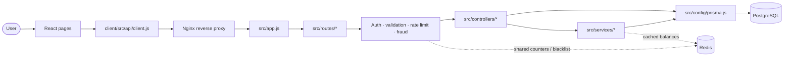

# Banking System — Interview Preparation

This guide turns the project bullets into a code-level explanation. It follows the real paths in this repository and calls out current limitations so you can describe the implementation accurately.

## 1. A concise project summary

> I built a full-stack banking demo with a React client and an Express API backed by PostgreSQL through Prisma. Transfers are recorded as a transaction plus matching debit and credit ledger entries inside one PostgreSQL transaction. A fraud middleware scores requests with deterministic rules and consults Gemini for higher-risk cases. Redis provides short-lived balance/user caching, token blacklist lookups, and shared rate-limit storage. Admin pages support fraud review, funding test accounts, user/ledger views, and the client can download PDF statements.

If the interviewer asks whether this is production-ready, be candid: it is a learning/demo system. The code demonstrates core patterns, but the security and money-precision caveats in section 9 need attention before handling real funds.

## 2. System map and entry points



| Entry point | What it starts |
|---|---|
| [docker-compose.yml](docker-compose.yml) | PostgreSQL, Redis, backend, and frontend containers. |
| [Dockerfile](Dockerfile) → [server.js](server.js) | Node backend process; `server.js` imports the Express app and listens on port 3000 inside Docker. |
| [src/app.js](src/app.js) | Express middleware, API routes, health endpoint, static serving, and error handling. |
| [client/index.html](client/index.html) → [client/src/main.jsx](client/src/main.jsx) | Browser HTML shell and React mount point. |
| [client/src/App.jsx](client/src/App.jsx) | Client-side routes, layout, and page access guards. |

## 3. Resume bullet: transactional banking and double-entry ledger

### Transfer request path

```text
Transfer.jsx
  → client/src/api/client.js: transactions.create(...)
  → Nginx /api proxy (Docker) or Vite proxy (development)
  → src/app.js: global middleware + transaction routes mounted
  → transaction.routes.js: auth → transaction rate limit → Zod validation → fraudCheck
  → transaction.controller.js: createTransaction
  → Prisma interactive transaction → PostgreSQL
  → JSON response → React success/error UI
```

### Files and responsibilities

| File | Important responsibilities/functions |
|---|---|
| [client/src/pages/dashboard/Transfer.jsx](client/src/pages/dashboard/Transfer.jsx) | Controlled form state; loads active accounts; submits sender, recipient, amount, and `crypto.randomUUID()` as an idempotency key. |
| [client/src/api/client.js](client/src/api/client.js) | `transactions.create(body)` sends JSON with `credentials: 'include'`; parses JSON and throws on non-2xx responses. |
| [src/routes/transaction.routes.js](src/routes/transaction.routes.js) | `POST /` composes `authMiddleware`, `transactionLimiter`, `validate(transferSchema)`, `fraudCheck`, and `createTransaction` in order. |
| [src/validators/transaction.validator.js](src/validators/transaction.validator.js) | `transferSchema` checks UUID strings, positive amount, maximum amount, idempotency key, and rejects same sender/recipient. |
| [src/middleware/auth.middleware.js](src/middleware/auth.middleware.js) | Validates the JWT and attaches the associated user to `req.user`. |
| [src/middleware/fraudCheck.js](src/middleware/fraudCheck.js) | Calls fraud analysis before the transaction controller; blocks or stores an alert and proceeds. |
| [src/controllers/transaction.controller.js](src/controllers/transaction.controller.js) | `createTransaction` checks account existence/status and balance, writes the transfer and ledger rows, invalidates cache, links the fraud alert, and returns a response. |
| [prisma/schema.prisma](prisma/schema.prisma) | `Transaction`, `Ledger`, statuses, UUIDs, Decimal amounts, indexes, and account relations. |

### What “double-entry ledger” means here

The `Ledger` table stores immutable-style debit/credit records instead of an account's current balance. For a transfer of amount **A**:

| Entry | Account | Ledger type | Amount |
|---|---|---|---:|
| 1 | Sender | debit | A |
| 2 | Recipient | credit | A |

`getBalance()` computes `sum(credits) - sum(debits)`. Keeping the history as entries gives the app an auditable record of how balances changed. The database schema does not enforce a cross-row invariant that every transaction has exactly one balanced pair; the controller is responsible for writing the pair atomically.

### Transaction safeguards in `createTransaction`

1. Loads sender and recipient records; rejects missing accounts.
2. Looks up the unique `idempotencyKey`; returns a status message for an existing transaction.
3. Requires both accounts to be active.
4. Starts Prisma's interactive `$transaction` callback.
5. Locks the sender row with `SELECT ... FOR UPDATE`.
6. Aggregates sender credits/debits inside the transaction and rejects insufficient funds.
7. Creates a pending transaction, a sender debit, and recipient credit; updates status to completed.
8. Commit occurs if callback succeeds; a thrown error rolls back all writes.
9. Invalidates both cached balances after commit.

**Why row locking?** Two simultaneous transfers could otherwise both read the same old balance and each spend it. Locking the sender row serializes those balance checks for that sender. The balance used for the decision is recomputed from PostgreSQL inside the transaction; it does not use the Redis cache.

**Why idempotency?** A client may retry after a timeout without knowing whether the first request committed. The database's unique constraint on `Transaction.idempotencyKey` prevents two committed rows with the same key. The current lookup happens before the transaction, so simultaneous requests with the same key may still produce a uniqueness error instead of returning the first result; robust idempotency should catch that conflict and return the stored transaction.

## 4. Resume bullet: heuristic rules + Gemini fraud detection

### Fraud request path

```text
POST /api/transactions
  → authMiddleware
  → transactionLimiter
  → transferSchema validation
  → fraudCheck middleware
      → fraudDetection.analyzeTransaction(...)
          → runRuleChecks(...)
          → maybe getAIAnalysis(...) via @google/genai
      → risk < 30: continue, no alert
      → risk >= 30: create FraudAlert
          → shouldBlock: return 403; do not call transfer controller
          → otherwise attach req.fraudAlert and continue
  → createTransaction
      → link saved alert to resulting transaction
```

| File/function | Role |
|---|---|
| [src/middleware/fraudCheck.js](src/middleware/fraudCheck.js) → `fraudCheck` | Integrates fraud scoring into the HTTP route; creates alerts and makes block/continue decision. |
| [src/services/fraudDetection.js](src/services/fraudDetection.js) → `runRuleChecks` | Deterministic scoring based on transaction/account history. |
| `getRiskLevel(score)` | Maps a score to `low`, `medium`, `high`, or `critical`. |
| `getAIAnalysis(context)` | Sends a compact transaction context to Gemini and parses its JSON verdict. |
| `analyzeTransaction(...)` | Orchestrates rules, risk bands, optional AI, and final `shouldBlock`. |
| [src/controllers/admin.controller.js](src/controllers/admin.controller.js) → `getFraudAlerts`, `reviewFraudAlert` | Lists and reviews alerts; confirming fraud freezes the sender account. |
| [client/src/pages/admin/FraudAlerts.jsx](client/src/pages/admin/FraudAlerts.jsx), [FraudAlertDetail.jsx](client/src/pages/admin/FraudAlertDetail.jsx) | Alert list/filter UI and review detail/actions. |

### Rules implemented in the current service

| Signal | Trigger | Score added |
|---|---:|---:|
| High amount | Over ₹50,000 and up to ₹200,000 | 20 |
| Very high amount | Over ₹200,000 | 35 |
| 1-hour velocity | At least 5 completed sender transactions in the last hour | 25 |
| 10-minute rapid fire | At least 3 completed sender transactions in the last 10 minutes | 30 |
| Odd hours | Local India time from 1:00 AM up to (not including) 5:00 AM | 15 |
| New account | Sender account younger than 24 hours | 10 |
| Near drain | Proposed transfer would leave less than 5% of current balance | 20 |

Scores are capped at 100. The high and very-high amount conditions are mutually exclusive. Velocity counts completed transactions already in the database, not the request currently being evaluated.

### Decision policy implemented

- **0–29, low:** allow and do not create a fraud alert.
- **30–49, medium:** create an alert, then allow.
- **50–79, high:** ask Gemini; `FRAUDULENT` blocks and adds 15, `SUSPICIOUS` adds 5, `SAFE` leaves the rule score. Allowed cases are alerted.
- **80–100, critical:** automatically block without calling Gemini.
- If Gemini is missing or fails, it returns `UNKNOWN`; this code does not block on `UNKNOWN`, so a 50–79 score is allowed but flagged.

The AI is a second opinion over rule results, not the source of transaction truth. The database transaction and validation remain responsible for whether money moves.

## 5. Resume bullet: Redis caching, blacklist, and rate limits

| Use | Code path | Behavior |
|---|---|---|
| Balance cache | [src/utils/balance.js](src/utils/balance.js) → `getBalance`, `invalidateBalanceCache` | Cache key `balance:<accountId>`, 30-second TTL; on Redis error, reads PostgreSQL; transfer/seed paths delete both affected balances after updates. |
| User cache | [src/middleware/auth.middleware.js](src/middleware/auth.middleware.js) → `getCachedUser` | Key `user:<userId>`, 600-second TTL; removes password before caching user data. |
| Token blacklist | `isTokenBlacklisted` in the auth middleware; logout controller in [src/controllers/auth.controller.js](src/controllers/auth.controller.js) | Check Redis SET first, then PostgreSQL fallback; logout writes blacklist to both stores. |
| Shared rate limits | [src/middleware/rateLimiter.js](src/middleware/rateLimiter.js) | `rate-limit-redis` uses Redis `sendCommand`; global 100 per 15 minutes, auth 5, transaction 20. |
| Redis connection | [src/config/redis.js](src/config/redis.js) | Ioredis client, connection/error logs, retry strategy, TLS option for `rediss://`. |

**Why Redis and PostgreSQL together for blacklist?** Redis makes frequent checks fast. PostgreSQL is the durable fallback if a token is not in Redis or Redis is unavailable. The current design stores whole token strings; a production design should expire blacklist entries at the JWT expiry and consider storing a token identifier/hash rather than the bearer token itself.

**Why Redis for rate limits?** If each backend worker kept its own in-memory count, users could exceed the intended limit by spreading requests across workers. A shared Redis store gives workers a common counter.

## 6. Resume bullet: React dashboard, workflows, and PDF statements

### Client request path

```text
client/src/App.jsx route
  → page component under client/src/pages/
  → client/src/api/client.js helper
  → browser fetch with credentials: 'include'
  → Nginx /api proxy or Vite development proxy
  → Express route/controller
```

| User-facing feature | Client files | API path / backend handler |
|---|---|---|
| Login/session | `client/src/pages/Login.jsx`, `client/src/context/AuthContext.jsx` | `POST /api/auth/login`, then `GET /api/auth/me`; cookie is HTTP-only. |
| Account overview | `client/src/pages/dashboard/Dashboard.jsx` | `GET /api/accounts`, `GET /api/accounts/balance/:id`; `account.controller.js`. |
| Transfer | `client/src/pages/dashboard/Transfer.jsx` | `POST /api/transactions`; route + fraud middleware + `createTransaction`. |
| History/filter | `client/src/pages/dashboard/Transactions.jsx` | `GET /api/transactions`; `getTransactionHistory`. |
| PDF statement | Transactions page + `downloadStatement()` in `client/src/api/client.js` | `GET /api/transactions/statement`; `getTransactionStatement` streams a PDFKit document. |
| Fraud review | `client/src/pages/admin/FraudAlerts.jsx`, `FraudAlertDetail.jsx` | `GET /api/admin/fraud-alerts`, `PATCH /api/admin/fraud-alerts/:id/review`. |
| Admin funding | `client/src/pages/admin/SeedFunds.jsx` | `GET /api/admin/accounts`, `POST /api/admin/seed-funds`; `listAllAccounts`, `seedFunds`. |
| Users/ledger | `Users.jsx`, `Ledger.jsx`, `AdminDashboard.jsx` | Admin routes for paginated users, ledger rows, and fraud statistics. |

### PDF statement implementation

`transaction.routes.js` protects `GET /statement` with `authMiddleware`. `getTransactionStatement`:

1. Requires `accountId` and checks the account belongs to the signed-in user.
2. Applies optional `fromDate` / `toDate` filters and reads up to 500 matching transactions.
3. Gets holder and current balance.
4. Creates a PDFKit `PDFDocument`, sets `Content-Type: application/pdf`, pipes it directly to the HTTP response, writes header/account/transaction rows/footer, then calls `doc.end()`.

Streaming avoids building a second full PDF buffer in memory. The client converts the response to a `Blob`, creates a temporary object URL, and clicks a download link.

## 7. Important syntax and concepts to explain

### Express middleware composition

```js
router.post('/', authMiddleware, transactionLimiter,
  validate(transferSchema), fraudCheck, transactionController.createTransaction);
```

Each function receives `(req, res, next)`. It can reject with an error/response or call `next()` to pass control. Order matters: validation runs before fraud code consumes the body; fraud runs before money is written.

### Async error wrapper

`catchAsync` in [src/utils/catchAsync.js](src/utils/catchAsync.js) turns a rejected async handler into `next(error)`, so the global error handler can produce a consistent response instead of an unhandled promise rejection.

### Zod validation

`validate(schema, source)` in [src/middleware/validate.js](src/middleware/validate.js) uses `schema.safeParse(...)`. `safeParse` returns a success/error result rather than throwing; on success parsed/transformed data replaces `req.body`, `req.query`, or `req.params`.

### Prisma transaction callback

```js
await prisma.$transaction(async (tx) => {
  // use tx.account / tx.ledger / tx.transaction here
});
```

`tx` is the transaction-scoped Prisma client. If the callback throws, Prisma rolls back; if it resolves, Prisma commits. All operations that must succeed or fail together belong inside this callback.

### React state and JSX

- `useState(value)` stores UI state; its setter schedules a render.
- `useEffect(fn, [])` runs once after mount; `[filters]` runs after mount and when filters change.
- `value={email}` plus `onChange={...}` creates a controlled form input.
- `{array.map(item => <Row key={item.id} />)}` renders a list; `key` helps React track rows.
- `{condition ? A : B}` and `{condition && <Element />}` are conditional UI.
- `?.` is optional chaining; `??` supplies a fallback only for `null` / `undefined`; `||` also treats empty/zero values as false.
- `...current` object spread copies prior fields before overwriting selected fields.
- `async/await` handles Promises; `try/catch/finally` reports errors and resets loading state.

## 8. Common interviewer questions

### “How do you prevent double spending?”

> I lock the sender account row with `SELECT ... FOR UPDATE` inside the Prisma transaction, then aggregate ledger credits and debits in PostgreSQL while holding that lock. Concurrent transfers from the same account wait and re-check the updated balance. I write the transaction, debit, credit, and completed status in the same DB transaction, so a failure rolls the set back.

### “Why derive balance from the ledger instead of storing it?”

> The ledger is the source of truth and preserves the history of every debit/credit. The balance is computed as credits minus debits. Redis caches this read briefly, but successful writes invalidate the cache; correctness-sensitive transfer checks query PostgreSQL inside the transaction.

### “What does Gemini add if there are already rules?”

> The rules are fast and deterministic. The current code consults Gemini only for rule scores from 50 through 79, giving it context such as amount, account age, balance, velocity, time, and triggered rules. Gemini returns SAFE, SUSPICIOUS, or FRAUDULENT; a critical score blocks automatically without a model call. Model failure currently produces UNKNOWN and leaves the transaction flagged but allowed.

### “How does a fraud alert get reviewed?”

> The middleware stores a `FraudAlert`. If a transaction is allowed, `createTransaction` links the alert to the new transaction. Admin routes require both authentication and the `admin` role. The admin can dismiss or confirm fraud; confirming fraud freezes the sender account.

### “How does auth work across frontend and API?”

> Login sets a JWT in an HTTP-only cookie. The React API wrapper uses `credentials: 'include'`; Express auth middleware reads the cookie, checks revocation, verifies the JWT, loads the user, and attaches it to `req.user`. React Context fetches `/auth/me` on startup to restore UI state. Admin APIs also have server-side role authorization.

### “What is stored in Redis?”

> Short-lived balance and user cache values, a token blacklist set, and rate-limit counters. PostgreSQL remains the durable source for banking records and token blacklist fallback.

## 9. Be honest about current gaps

These are important to mention if asked about limitations. They are also good follow-up improvements to make before describing the app as secure or production-ready.

1. **Transfer sender ownership is not enforced in the current controller.** `createTransaction` checks that `fromAccount` exists and is active, but I do not see a check that `fromUserAccount.userId === req.user.id` (or that the caller is a system/admin principal). This is a serious authorization gap. Add that check before fraud analysis/transfer, and test that another user's account cannot be debited.
2. **README fraud claims exceed the active implementation.** The current `fraudDetection.js` implements amount, velocity, rapid-fire, odd-hours, new-account, and near-drain checks. It does not currently implement self-transfer or round-amount rules; same-account transfers are instead rejected by Zod validation.
3. **Money arithmetic uses JavaScript numbers in several places.** PostgreSQL columns are `Decimal(15,2)`, but code parses aggregates to `Number` and accepts JS numbers. For real financial correctness use integer minor units or Prisma Decimal end-to-end and define currency rounding rules.
4. **Idempotency race handling can improve.** Unique key protects the database, but lookup-before-transaction is not a fully race-safe response path. Handle unique-constraint conflicts by loading/returning the existing transaction.
5. **Token blacklist retention needs expiry cleanup.** Blacklisted JWTs should be kept only through their expiration; consider storing `jti`/hash rather than the raw token.
6. **Email is best-effort and external.** Gmail auth failures are caught/logged; notification failure should not undo a committed transfer. Avoid claiming email delivery is guaranteed.
7. **Gemini output is not a replacement for controls.** The service expects strict JSON and handles parsing/API failures as UNKNOWN. Keep allow/block behavior conservative and auditable; never let model output perform writes directly.

## 10. Suggested code-reading order

1. [src/routes/transaction.routes.js](src/routes/transaction.routes.js) — see the ordered request pipeline.
2. [src/middleware/auth.middleware.js](src/middleware/auth.middleware.js) — see identity and revocation checks.
3. [src/validators/transaction.validator.js](src/validators/transaction.validator.js) and [src/middleware/validate.js](src/middleware/validate.js) — see input contract.
4. [src/middleware/fraudCheck.js](src/middleware/fraudCheck.js) — see allow, flag, and block decisions.
5. [src/services/fraudDetection.js](src/services/fraudDetection.js) — learn individual rules and Gemini call.
6. [src/controllers/transaction.controller.js](src/controllers/transaction.controller.js) — trace ledger and PDF paths.
7. [src/utils/balance.js](src/utils/balance.js), [src/config/prisma.js](src/config/prisma.js), [src/config/redis.js](src/config/redis.js) — understand persistence and cache.
8. [src/controllers/admin.controller.js](src/controllers/admin.controller.js) — follow funding, review, freeze, user, and ledger operations.
9. Client: [Transfer.jsx](client/src/pages/dashboard/Transfer.jsx) → [client.js](client/src/api/client.js) → [Transactions.jsx](client/src/pages/dashboard/Transactions.jsx) → [FraudAlerts.jsx](client/src/pages/admin/FraudAlerts.jsx).

> **Interview tip:** explain one flow end to end first (transfer is best), then zoom into ACID/locking, fraud scoring, or Redis when asked. Be precise about what the current code implements and name the authorization gap as a high-priority hardening item.
